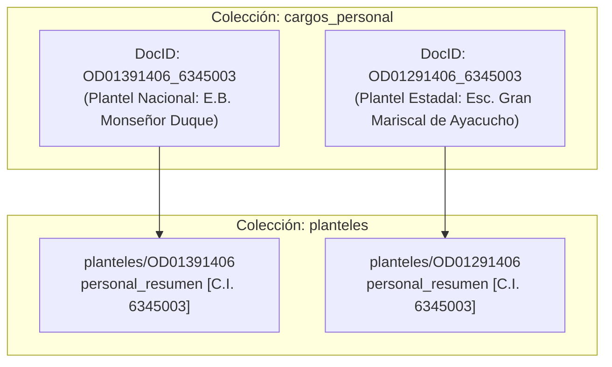

# INFORME TÉCNICO Y ADMINISTRATIVO
## Lineamientos de Duplicidad de Personal y Pluriempleo en la Plataforma SGH-MR

**Fecha de Emisión:** 7 de Noviembre de 2026  
**Área Responsable:** Soporte Técnico y Gestión Humana — CDCE Mérida  
**Referencia Técnica:** Base de Datos Cloud Firestore (`sgh-merida`) / Matriz de Nómina Ministerial MPPE (`RAC.xlsx`)

---

### 1. Resumen Ejecutivo

En el marco de la auditoría y regularización de expedientes de personal en el Sistema de Gestión Humana (SGH-MR), se establece formalmente el criterio técnico, legal y operativo para la coexistencia de registros asociados a una misma cédula de identidad en la base de datos de personal docente, administrativo y obrero del Estado Bolivariano de Mérida.

> **Nota:** La presencia de una misma cédula con más de un expediente en la base de datos **sí está contemplada, es técnicamente viable y administrativamente legítima** bajo supuestos normativos específicos (pluriempleo docente, horas compartidas y doble dependencia presupuestaria). En la nómina ministerial centralizada de Mérida (`RAC.xlsx`) existen actualmente **223 funcionarios con doble cargo oficial activo**.

---

### 2. Arquitectura Técnica en Cloud Firestore

La estructura de almacenamiento de SGH-MR en Google Cloud Firestore fue diseñada para soportar de manera nativa la multiplicidad de cargos por institución sin riesgo de sobreescritura accidental:



1. **Estructura Canónica de la Clave Primaria:**
   * En la colección `cargos_personal`, el identificador de documento oficial corresponde a la clave compuesta:
     $$\text{docId} = \text{codigoDEA\_cedula}$$
   * Al incorporar el código DEA institucional como prefijo, la base de datos permite registrar al mismo funcionario en dos planteles educativos distintos sin colisión de llaves.
2. **Sincronización en Planteles:**
   * Cada institución educativa (`planteles/{dea}`) mantiene su propio arreglo de `personal_resumen`, conteniendo exclusivamente al personal adscrito a su sede física y turnos de atención.

---

### 3. Casos Legítimos: Cuándo SÍ Procede la Duplicidad en la Base de Datos

#### A. Doble Dependencia Presupuestaria (Nacional + Estadal)
* **Definición:** Funcionario que ostenta simultáneamente un nombramiento remunerado con fondos del **Ministerio del Poder Popular para la Educación (MPPE - Nómina Central)** y otro cargo remunerado por la **Gobernación del Estado Bolivariano de Mérida (Dirección de Educación Estadal)**.
* **Fundamento:** Son fuentes presupuestarias y patronos jurídicamente diferenciados.
* **Casos Reales Constatados en Mérida (`RAC.xlsx`):**
  * **C.I. 3.766.563 (Juan Alberto Quintero Bastardo):**  
    - Cargo 1: *CB- Tulio Febres Cordero* (`T0099D1412`) — Dependencia **Nacional** (40 hrs).  
    - Cargo 2: *Complejo Educativo María Rosario Nava* (`OD17271412`) — Dependencia **Estadal** (40 hrs).
  * **C.I. 6.345.003 (Cruz del Valle Rojas Games):**  
    - Cargo 1: *E.B. Monseñor Duque* (`OD01391406`) — Dependencia **Nacional** (40 hrs).  
    - Cargo 2: *Escuela Gran Mariscal de Ayacucho* (`OD01291406`) — Dependencia **Estadal** (40 hrs).
  * **C.I. 6.729.339 (Luz Marina Rivas de Rodríguez):**  
    - Cargo 1: *CB- Tulio Febres Cordero* (`T0099D1412`) — Dependencia **Nacional** (40 hrs).  
    - Cargo 2: *Complejo Educativo Emiro Fuenmayor* (`S2860D1412`) — Dependencia **Estadal** (40 hrs).

#### B. Horas Compartidas en Media General y Media Técnica (Docentes Especialistas)
* **Definición:** Docentes que imparten asignaturas especializadas (Matemáticas, Física, Química, Biología, Inglés, etc.) que dividen sus horas académicas entre dos o más liceos para completar su carga horaria.
* **Ejemplo:** 18 horas semanales en el Liceo A y 18 horas semanales en el Liceo B.
* **Regulación por el Escudo de SGH (v2.18.0):**  
  El motor `verificarTopeHorasDocente` suma en memoria las horas de todos los planteles donde está activa la cédula y valida los topes máximos legales:
  * **Tope en Media General / Media Técnica:** Máximo acumulado de **56.00 horas académicas semanales**.
  * **Tope en Primaria / Inicial:** Máximo acumulado de **53.33 horas académicas semanales**.

#### C. Docente de Aula Regular + Modalidad / Especialidad (Turnos Opuestos)
* **Definición:** Personal que cumple funciones de aula regular durante un turno (ej. Mañana en Primaria) y en el turno opuesto labora en instituciones de modalidades específicas:
  * Modalidad de Educación Especial (Aulas Integradas, Talleres Laborales).
  * Centros de Educación de Adultos (CEA) o Escuelas de Emprendimiento.
* **Requisito Indispensable:** Certificación de compatibilidad horaria estricta entre ambos turnos de trabajo.

#### D. Sedes Base y Extensiones / Núcleos Escolares Rurales (NER)
* Docentes itinerantes o coordinadores que atienden la sede principal de un NER y extienden horas en una unidad de producción o escuela unitaria anexa con código DEA independiente.

---

### 4. Casos Ilegítimos: Cuándo NO Debe Existir Duplicidad

| Tipo de Irregularidad | Causa Raíz | Impacto en SGH | Tratamiento Administrativo Correcto |
| :--- | :--- | :--- | :--- |
| **Duplicado en el Mismo Plantel** | Registro legado sin prefijo DEA (`{cedula}`) coexistiendo con `{dea}_{cedula}`. | Infla la nómina del plantel; genera doble conteo en cuadratura. | Normalización *in-situ* de la clave; preservación del expediente único y eliminación del clon. |
| **Incompatibilidad Horaria Absoluta** | Dos cargos de tiempo completo (40 hrs) asignados en el mismo turno físico. | Imposibilidad física de cumplimiento laboral. | Sinceración de horario o renuncia/licencia en uno de los cargos ante el CDCE. |
| **Exceso de Carga Horaria Acumulada** | Sumatoria total de horas en planteles superior a 56 hrs en Media o 53.33 hrs en Primaria. | Bloqueo preventivo en formulario web de SGH (v2.18.0). | Reasignación o reducción de horas hasta ajustarse al techo legal. |
| **Traslado No Tramitado ("Personal Fantasma")** | Funcionario reubicado en un nuevo plantel sin darle salida en el plantel anterior. | Aparece activo en dos planteles cuando solo labora en uno. | Emisión y recepción de la **Ficha Viajera de Traslado** en SGH (`personal_traslados`). |
| **Homonimia o Error de Tipeo** | Un plantel intenta registrar a un trabajador usando la cédula de otro funcionario. | Colisión de identidad y riesgo de sobreescritura. | Verificación inmediata con cédula de identidad laminada original. |

---

### 5. Protocolo de Diagnóstico Rápido para Casos Dudosos

Al analizar un caso reportado con sospecha de duplicidad, seguir la siguiente regla de decisión:

```text
¿La misma cédula está reportada en dos planteles diferentes?
├── SI: ¿Las instituciones tienen códigos DEA distintos?
│   ├── SI: ¿Tienen turnos compatibles y la suma de horas no supera 56 hrs?
│   │   ├── SI: ✅ DUPLICIDAD VÁLIDA (Doble dependencia o pluriempleo legal).
│   │   └── NO: ❌ IRREGULARIDAD (Incompatibilidad horaria o sobrecarga).
│   └── NO: ❌ DUPLICADO INDEBIDO (Error de registro interno en el mismo plantel).
└── NO: Expediente único estándar.
```

---

_Documento técnico elaborado por Antigravity para la Dirección de Gestión Humana y Soporte Técnico del CDCE Estado Bolivariano de Mérida._

