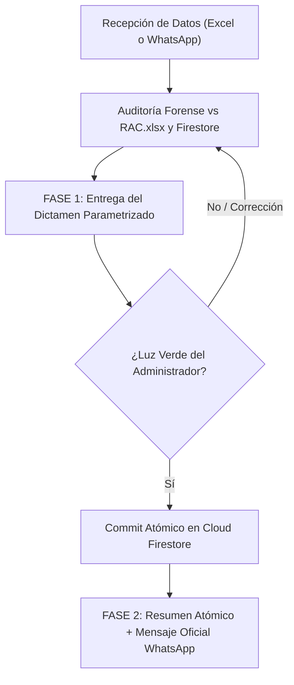

# Parametrización del Protocolo CASO_HUERFANOS
**Sistema de Gestión Humana (SGH 2.0) – CDCE Estado Bolivariano de Mérida**  
*Documento de Estandarización de Procesos, Reglas de Auditoría y Formatos de Comunicación Oficial*

---

## 1. Propósito y Principios Rectores

El protocolo **`CASO_HUERFANOS`** es el procedimiento técnico-forense y administrativo estandarizado para auditar, sanear y regularizar al personal docente, administrativo y obrero que labora activamente en los planteles educativos pero que no se encuentra reflejado en las nóminas institucionales de la plataforma web SGH.

### Principios Obligatorios:
1. **Filtrado Estricto de Datos de Entrada:**  
   Independientemente de la modalidad de recepción (archivos Excel o mensajes informales de WhatsApp enviados por los directores), el análisis se concentra exclusivamente en tres variables críticas:
   * **Código DEA del Plantel**
   * **Número de Cédula de Identidad**
   * **Nombres y Apellidos**  
   *(Se descartan de forma autónoma comentarios adicionales, justificaciones o textos accesorios enviados por las instituciones).*

2. **Política de CERO DUPLICADOS (Zero-Collision):**  
   * Nunca se sobrescribe ni se duplica un funcionario que ya posea un expediente activo en la base de datos de Cloud Firestore (`cargos_personal`).
   * En casos de **Pluriempleo / Doble Cargo Legítimo** (Nacional + Estadal comprobado en nómina ministerial RAC), el segundo cargo se incorpora con clave compuesta `{codigoDEA}_{cedula}`, preservando íntegro el cargo previo y vinculando ambos a sus respectivos planteles.
   * Si un funcionario ya existe en `cargos_personal` pero fue omitido en el listado del colegio (`planteles/{dea}.personal_resumen`), se enlaza atómicamente a la nómina institucional **sin duplicar** su documento de cargo.

3. **Arquitectura Zero-Cost y Verificación Previa:**  
   Ninguna operación de escritura se efectúa en la base de datos sin la presentación del dictamen de auditoría y la recepción explícita de la **"luz verde"** de la administración.

---

## 2. Modalidades de Entrada Soportadas

* **Modalidad A: Archivo Excel:** Archivos estructurados depositados en el directorio `huerfanos/{municipio}.xlsx`.
* **Modalidad B: Reportes de Mensajería (Directores):** Mensajes de texto planos o aleatorios remitidos por directivos a las coordinaciones del CDCE.

---

## 3. Flujo Operativo en Dos Fases Parametrizadas

El protocolo se ejecuta invariablemente en **dos fases secuenciales**:



---

### FASE 1: Diagnóstico Forense y Solicitud de Luz Verde
*(No se realiza ninguna escritura en Cloud Firestore)*

La respuesta de Fase 1 debe respetar la siguiente estructura canónica:

1. **Encabezado y Confirmación de Auditoría:**  
   Identificación del municipio, ámbito parroquial y confirmación del cruce exhaustivo contra `RAC.xlsx` y `cargos_personal` en Firebase.

2. **Balance General de la Auditoría (Tabla Resumen):**  
   Clasificación cuantitativa en las 4 categorías operativas:

   | Categoría | Total | Dictamen Técnico y Forense |
   | :--- | :---: | :--- |
   | **1. Huérfanos Legítimos Confirmados en RAC** | *N* | Inexistentes en Firebase. Coincidencia ministerial 100% en cargo, horas y código DEA. Listos para inyección formal. |
   | **2. Preexistentes en Firebase (PROTEGIDOS)** | *N* | Ya se encuentran registrados y activos en la base de datos estadal. Se protegen estrictamente (**0% alteraciones, 0% duplicados**). |
   | **3. Discrepancia de Sede en RAC** | *N* | Personal activo en nómina ministerial pero asignado oficialmente a otro plantel según RAC. |
   | **4. En Observación (No encontrados en RAC)** | *N* | Personal no ubicado en nómina central MPPE RAC (Madres cocineras comunales, nuevo ingreso maternal, obreros locales o validación de C.I.). |
   | **Total Evaluado** | *Total* | **100% auditado y clasificado** |

3. **Hallazgos Forenses Destacados en el Cruce:**  
   * Detección y corrección de códigos DEA omitidos o erróneos.
   * Resolución técnica de errores tipográficos en números de cédula (dígitos excedentes o transposiciones).
   * Identificación y protección de expedientes preexistentes y casos de pluriempleo legítimo.

4. **Distribución de los Huérfanos Confirmados a Incorporar:**  
   Desglose agrupado por cada centro educativo:
   * 📍 **CODIGO DEA - NOMBRE DEL PLANTEL** (*Cantidad*):
     - `NOMBRE Y APELLIDO | C.I. V-XX.XXX.XXX (Cargo – Horas – Condición Titular/Contratado)`

5. **Cierre de Fase 1:**  
   Frase de cierre obligatoria:  
   *«Quedo a la espera de tu **luz verde** para proceder con la inyección atómica en Cloud Firestore y generar el reporte oficial para WhatsApp.»*

---

### FASE 2: Ejecución Atómica y Entrega del Comunicado Oficial
*(Se ejecuta únicamente tras recibir la "luz verde")*

1. **Ejecución Técnica en Servidor:**  
   * Creación de documentos canónicos en `cargos_personal/{dea}_{ci}` con campos normalizados en minúsculas (`cedula`, `codigo-plantel`, `nombre-apellido`, `cargo`, `dependencia`, etc.) y llaves complementarias en mayúsculas.
   * Transformación atómica `appendMissingElements` en `planteles/{dea}.personal_resumen`.
   * Incremento del contador institucional `planteles/{dea}.total_personal`.
   * Para preexistentes omitidos en el colegio, inserción en `personal_resumen` protegiendo su expediente de duplicidad.

2. **Resumen de la Ejecución Atómica:**  
   Presentación concisa del resultado de la transacción:
   * *N* Huérfanos Legítimos Incorporados.
   * *N* Preexistentes Protegidos (0% duplicados).
   * *N* En Observación (sin alteración de base de datos).
   * Detalle de la transacción atómica (operaciones consolidadas en commit único HTTP 200).

3. **Mensaje Oficial para WhatsApp (Plantilla Canónica Unificada):**  
   Bloque de texto listo para copiar y difundir a los directores, gobernación y CDCE:

```text
*INFORME OFICIAL: REGULARIZACIÓN DE PERSONAL NO REFLEJADO EN PLANTEL*
*MUNICIPIO {MUNICIPIO} – ESTADO BOLIVARIANO DE MÉRIDA*

Saludos cordiales. Se informa la resolución y vinculación formal del personal que labora en las instituciones educativas y no se encontraba reflejado en la plataforma SGH:

*DATOS DE LA INSTITUCIÓN:*
• *Municipio:* {MUNICIPIO}
• *Instituciones Atendidas:* {N_PLANTELES} Planteles Educativos
• *Dependencia:* Nacional y Estadal

*1. PERSONAL VINCULADO E INCORPORADO AL SISTEMA ({N_INCORPORADOS}):*
_(Personal activo en nómina central ministerial RAC que fue asociado formalmente a su plantel)_

📍 *{CODIGO_DEA} - {NOMBRE_PLANTEL}* ({CANTIDAD}):
• *{NOMBRE_COMPLETO}* | C.I. V-{CEDULA_FORMATEADA}
  _Cargo:_ {CARGO} ({HORAS} hrs - {CONDICION}) – _Tipo:_ {TIPO} – Activo(a)

*2. PERSONAL PREEXISTENTE VERIFICADO EN SISTEMA ({N_PREEXISTENTES}):*
_(Personal que ya se encontraba registrado y activo en la plataforma oficial. Sus expedientes se preservan sin alteraciones ni duplicados para gestión directa por su directivo)_

📍 *{CODIGO_DEA} - {NOMBRE_PLANTEL}* ({CANTIDAD}):
• *{NOMBRE_COMPLETO}* | C.I. V-{CEDULA_FORMATEADA} – _Cargo:_ {CARGO} – _Tipo:_ {TIPO} – Activo(a)

*3. CASOS EN OBSERVACIÓN:*

*A. DISCREPANCIA DE SEDE EN RAC ({N_DISCREPANCIAS}):*
_(Personal activo en nómina ministerial RAC pero asignado formalmente a otro plantel. Requiere sinceración formal de traslado ante Zona Educativa)_
• *{NOMBRE_COMPLETO}* | C.I. V-{CEDULA_FORMATEADA}
  _Solicitado en:_ {DEA_SOLICITADO}
  _Sede Oficial en RAC:_ {DEA_RAC} ({NOMBRE_PLANTEL_RAC})

*B. NO LOCALIZADOS EN NÓMINA CENTRAL RAC ({N_NO_RAC}):*
_(Personal no ubicado en la nómina central MPPE RAC: Madres Cocineras CNAE locales, personal obrero/vigilante comunal, maternal nuevo ingreso o revisión de cédula)_
• *{NOMBRE_COMPLETO}* | C.I. V-{CEDULA_FORMATEADA} ({CODIGO_DEA} - {NOMBRE_PLANTEL})

*4. CONTROL DE INTEGRIDAD Y SEGURIDAD:*
• 100% de coincidencia ministerial vs. nómina oficial RAC en los casos incorporados.
• 0% de duplicados en la base de datos estadal ({N_PREEXISTENTES} registros preexistentes protegidos).
• Nóminas institucionales sincronizadas en personal_resumen protegiendo los datos de matrícula.

_Lic. Luis Perez Soporte técnico y Gestión Humana - CDCE Mérida_
```

---

## 4. Archivos y Plantillas del Sistema Vinculadas

* **Plantilla de Respaldo:** [`templates/whatsapp_caso_huerfanos.txt`](file:///c:/Proyectos/sgh-mr%20-%20firebase/templates/whatsapp_caso_huerfanos.txt)
* **Base de Datos Ministerial:** `RAC.xlsx` (30.323 funcionarios ministeriales en el Estado Bolivariano de Mérida).
* **Colecciones Afectadas en Firebase:**
  * `cargos_personal/{dea}_{ci}` (Expedientes individuales normalizados).
  * `planteles/{dea}` (Fichas institucionales con arreglos `personal_resumen` y contadores `total_personal`).
* **Control de Auditoría y Bitácora:** Registro riguroso y secuencial en `bitacora.md` y `conversaciones.md`.

